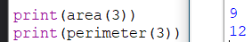
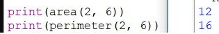
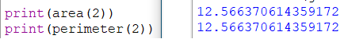
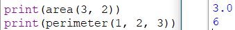

# Документация к модулю `geometric_lib`
## Общее описание решения
Модуль `geometric_lib` предназначен для работы в контексте двумерных простых геометрических фигур, собой представляет библиотеку для языка **Python**.
---
В текущей версии модуля реализована работа с такими фигурами, как:
```
- Прямоугольник
- Квадрат
- Треугольник
- Круг
```
## Описание всех функций
### Square.py
Содержит в себе две функции для получения периметра и площади квадрата.
#### area
```py
def area(a):
    '''принимает в качестве аргумента сторону квадрата a и возвращает
    площадь этого квадрата'''
    return a * a
```
Функция принимает в качестве аргумента число `int`/`float`, которое выражает длину стороны квадрата, и возвращает его площадь `int`/`float`.
#### perimeter
```py
def perimeter(a):
    '''принимает в качестве аргумента сторону квадрата a и возвращает
    периметр этого квадрата'''
    return 4 * a
```
Функция принимает в качестве аргумента число `int`/`float`, которое выражает длину стороны квадрата, и возвращает его периметр `int`/`float`.
---
### Rectangle.py
Содержит в себе функции для получения периметра и площади прямоугольника.
#### area
```py
def area(a, b):
    '''принимает в качестве аргумента стороны прямоугольника a, b
    и возвращает площадь этого прямоугольника'''
    return a * b
```
Функция принимает в качестве аргумента 2 числа `int`/`float`, которые выражают длины стороны прямоугольника, и возвращает его площадь `int`/`float`.
#### perimeter
```py
def perimeter(a, b):
    '''принимает в качестве аргумента стороны прямоугольника a, b
    и возвращает периметр этого прямоугольника'''
    return 2 * (a +  b)
```
Функция принимает в качестве аргумента 2 числа `int`/`float`, которые выражают длины стороны прямоугольника, и возвращает его периметр `int`/`float`.
---
### Circle.py
Содержит в себе две функции для получения длины окружности и площади круга. Для работы необходим встроенный модуль `math`.
#### area
```py
def area(r):
    '''принимает в качестве аргумента радиус окружности r и возвращает
    площадь этой окружности'''
    return math.pi * r * r
```
Функция принимает в качестве аргумента число `int`/`float`, которое выражает радиус окружности, и возвращает площадь этой же окружности `int`/`float`.
#### perimeter
```py
def perimeter(r):
    '''принимает в качестве аргумента радиус окружности r и возвращает
    длинну этой окружности'''
    return 2 * math.pi * r
```
Функция принимает в качестве аргумента число `int`/`float`, которое выражает радиус окружности, и возвращает длину этой же окружности `int`/`float`.
---
### Triangle.py
Содержит в себе две функции для получения периметра и площади треугольника.
#### area
```py
def area(a, h):
    '''принимает в качестве аргумента сторону a, высоту h треугольника
    и возвращает площадь этого треугольника'''
```
Функция принимает в качестве аргумента 2 числа `int`/`float`, которые выражают длину стороны треугольника  и длину высоты к этой же стороне соотвественно, и возвращает его площадь `int`/`float`.
#### perimeter
```py
def perimeter(a, b, c):
    '''принимает в качестве аргумента стороны a, b, c треугольника
    и возвращает периметр этого треугольника'''
    return a + b + c
```
Функция принимает в качестве аргумента 3 числа `int`/`float`, которые выражают длины стороны треугольника, и возвращает его периметр `int`/`float`.
# Примеры вызовов
### Square

### Rectangle

### Circle

### Triangle
